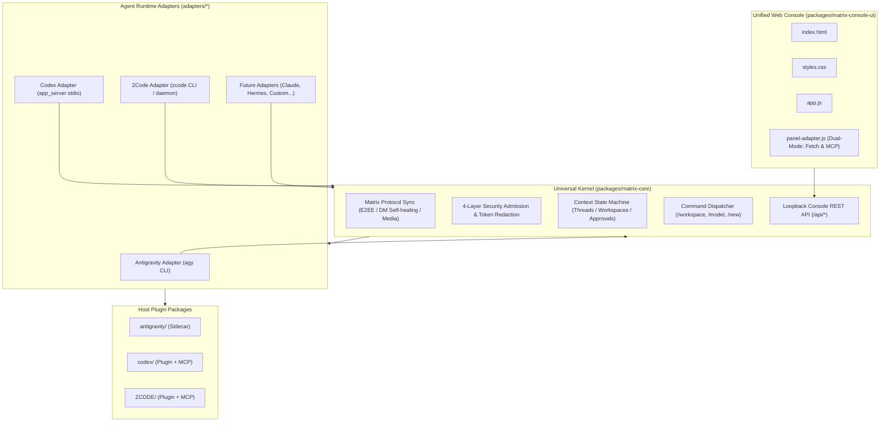

# Matrix Bridge

[](LICENSE)
[](https://nodejs.org/)
[](#architecture)
[](#testing)

**Matrix Bridge** is a unified, decentralized Matrix chat gateway and management platform for AI Agents. It enables AI coding assistants—such as **Google Antigravity**, **OpenAI Codex**, and **ZCode / Claude**—to communicate natively in Matrix rooms and direct messages with complete session isolation, multi-level workspace navigation, end-to-end encryption (Pantalaimon), and a modern web management console.

---

## 🌟 Key Highlights

- **🔌 Universal Core + Adapter Architecture**: 90% of Matrix protocol, security, and room management logic lives in `@matrix-bridge/core`. Adding a new Agent runtime takes fewer than 100 lines of code.
- **🛡️ 4-Layer Security Gate**:
  - **Federation Guard**: Blocks unauthorized foreign homeservers from accessing private workspaces.
  - **Admission Policy**: Configurable room and global access policies (`all`, `allowlist`, `admin`, `none`).
  - **Secret Redaction**: Automatically scrubs Matrix access tokens (`syt_`), OpenAI keys (`sk-`), GitHub tokens (`ghp_`), and SSH keys before storage or forwarding.
  - **Sliding-Window Rate Limiting**: Prevents flooding attacks while granting administrators unthrottled access.
- **💬 Intelligent Context & Thread Machine**:
  - **1-on-1 Direct Chats**: Instant 100% recognition with `account_data/m.direct` self-healing; no `@bot` prefix required.
  - **Multi-user Group Chats**: Auto-prefixes replies with `[Sender: Name (@id:server)]` so agents can distinguish different team members in the same discussion.
  - **Matrix Thread Sub-sessions**: Starting a thread on any message automatically branches an isolated agent session and replies back into that thread.
- **📂 Interactive Workspace Browser**:
  - Switch working directories dynamically in chat (`/workspace /path/to/project`) or via the web console.
  - Breadcrumb navigation, git repository detection, and multi-level child directory explorer.
- **🎨 Single Source of Truth Web Console**:
  - Dual-mode environment auto-sensing: runs seamlessly in both regular browsers (via HTTP `/api/*`) and inside desktop MCP App webviews (via `app.callServerTool`).
  - Adaptive Dark/Light theme following host IDE or system preferences.
- **📦 Zero-Dependency Kernel**:
  - `@matrix-bridge/core` is built purely on Node.js standard libraries (`node:fs`, `node:http`, `node:crypto`) without third-party runtime bloat.

---

## 🏗️ Architecture



---

## 🚀 Quick Start

### 1. Requirements

- **Node.js**: `>= 18.0.0`
- Any supported Agent CLI installed (one or more):
  - Google Antigravity (`agy` or `~/.gemini`)
  - OpenAI Codex (`codex` or `~/.codex`)
  - ZCode (`zcode` or `~/.zcode`)

### 2. Multi-Agent One-Click Installer

Matrix Bridge includes an interactive multi-agent installer that automatically detects the runtime environments on your machine:

```bash
# Clone the repository
git clone https://github.com/bigbearcool/matrix-bridge.git
cd matrix-bridge

# Run the installer
./install.sh
```

The installer presents an interactive menu to choose which agent platforms to install or update:

```text
 🔍 当前机器检测到的 Agent 运行时：
  [1] ● Antigravity (目录: ~/.gemini)
  [2] ● Codex (CLI: codex, 目录: ~/.codex)
  [3] ● ZCode (CLI: zcode, 目录: ~/.zcode)

请选择要安装/更新的运行时:
  1) 全部安装 (推荐)
  2) 仅 Antigravity
  3) 仅 Codex
  4) 仅 ZCode
  q) 退出
```

You can also run headless installs in CI/CD or scripts:

```bash
./install.sh --all            # Install to all detected agents
./install.sh --antigravity    # Install Antigravity plugin only
./install.sh --codex          # Install Codex plugin only
./install.sh --zcode          # Install ZCode plugin only
```

---

## 💬 In-Chat Slash Commands

Once connected in a Matrix room, administrators and authorized users can control the bridge with slash commands:

| Command | Usage | Description |
| :--- | :--- | :--- |
| `/status` | `/status` | View current bot connection, active workspace, model, and sync state |
| `/workspace` | `/workspace <path>` | Switch the agent's current working directory for this room |
| `/model` | `/model [name]` | View available models or switch the active model (e.g. `/model gemini-2.5-pro`) |
| `/effort` | `/effort [level]` | View or set reasoning effort (`low`, `medium`, `high`) |
| `/new` | `/new` | Reset current room conversation context and start a clean session |
| `/policy` | `/policy <all\|allowlist\|none>` | Configure the room admission policy (Admin only) |
| `/help` | `/help` | Display command usage and active adapter hints |

> **Note for Group Chats**: In group rooms, prefix commands with `@bot` (e.g. `@bot /workspace /my/project`) to avoid conflicts with other bots. In 1-on-1 direct messages, slash commands can be sent directly without mentioning the bot.

---

## 🛠️ Monorepo Development

```bash
# Build UI and sync Core + Adapters to all host distributions
npm run sync

# Build UI package only
npm run build:ui

# Run full test suite (Core + Adapters + Host integration)
npm test
```

### Test Coverage

The monorepo includes **87 automated test cases** executed with the built-in `node:test` runner:
- **`npm run test:core`** (51 tests): Matrix sync lifecycle, Pantalaimon E2EE, DM self-healing, multi-level path drilldown, security gates, instance lock, and REST APIs.
- **`npm run test:adapters`** (33 tests): `AgentRuntimeAdapter` contract conformance, process lifecycle, session resume, and model discovery.
- **`npm run test:codex`** (3 tests): Standalone daemon startup and MCP App stdio tool calls.

---

## 📖 Developer Documentation

For in-depth architectural rules, coding standards, and step-by-step guides on adding new agent adapters:
- [AGENTS.md](AGENTS.md) — Comprehensive guide for AI Agents and contributors.
- [CLAUDE.md](CLAUDE.md) — Quick reference for Claude Code & Cursor developers.

---

## 📄 License

This project is licensed under the [MIT License](LICENSE).
