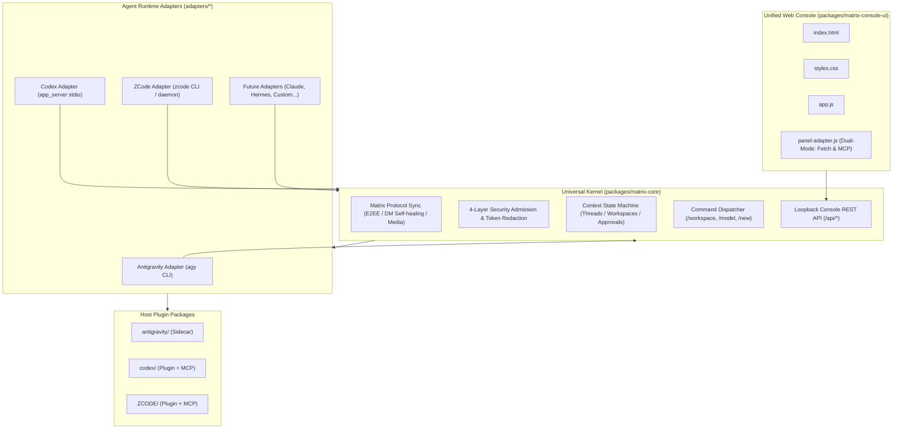

# Agents Matrix Bridge

<p align="center">
  <b>English</b> | <a href="README_CN.md">简体中文</a>
</p>

[](LICENSE)
[](https://nodejs.org/)
[](#architecture)
[](#testing)

**Agents Matrix Bridge** is a unified, decentralized Matrix chat gateway and management platform for multi-agent AI ecosystems. It enables diverse AI coding assistants—such as **Google Antigravity**, **OpenAI Codex**, and **ZCode / Claude**—to communicate natively in Matrix rooms and threads with complete session isolation, multi-level workspace navigation, end-to-end encryption (Pantalaimon), and a modern web management console.

---

## 🎯 Why Agents Matrix Bridge?

### The Problem: AI Agent Silos
Modern AI coding assistants are extraordinarily capable, but they are trapped inside proprietary, isolated silos:
- Google Antigravity lives in its own CLI/daemon.
- OpenAI Codex runs in its own app-server sandbox.
- Claude / ZCode operates in separate webviews or isolated workspaces.

To coordinate multiple agents, developers are forced to manually copy-paste code snippets, re-type prompts, manage divergent chat histories across tabs, and act as a human copy-paste router. There has been **no open, neutral communication bus** for AI agents to talk to each other and collaborate with human developers simultaneously.

### The Solution: Matrix as the Multi-Agent Neural Bus
**Matrix** is an open, decentralized, federated, and end-to-end encrypted protocol with native support for rooms, threads, state events, and media transfer:
1. **Multi-Agent Collaboration in One Room**: You can invite `@antigravity:server`, `@codex:server`, and `@zcode:server` into the **exact same Matrix room**. Antigravity can formulate architectural blueprints, Codex can implement modules in parallel threads, and ZCode can run audits and generate test suites.
2. **Ubiquitous Human Supervision**: Engineers can monitor, intervene, review code diffs, approve command executions, or steer conversations from **any Matrix client** (Element on iOS/Android/Mac/Windows, FluffyChat, or Cinny) on the go.
3. **Decentralized & Privacy-First**: Run your own Matrix homeserver (or lightweight Conduit in Docker). No conversations, tokens, or proprietary intellectual property leave your private infrastructure.

---

## 🌟 Key Highlights

- **🔌 Universal Core + Adapter Architecture**: 90% of Matrix protocol, security, and room management logic lives in `@matrix-bridge/core`. Adding a new Agent runtime takes fewer than 100 lines of code.
- **🛡️ 4-Layer Security Gate**:
  - **Federation Guard**: Blocks unauthorized foreign homeservers from accessing private workspaces.
  - **Admission Policy**: Configurable room and global access policies (`all`, `allowlist`, `admin`, `none`).
  - **Secret Redaction**: Automatically scrubs Matrix access tokens (`syt_`), OpenAI keys (`sk-`), GitHub tokens (`ghp_`), and SSH keys before storage or forwarding.
  - **Sliding-Window Rate Limiting**: Prevents flooding attacks while granting administrators unthrottled access.
- **💬 Intelligent Context & Thread Machine**:
  - **1-on-1 Direct Chats**: Instant 100% recognition with `account_data/m.direct` self-healing; no `@bot` prefix required.
  - **Multi-user Group Chats**: Auto-prefixes replies with `[Sender: Name (@id:server)]` so agents can distinguish different team members in the same discussion.
  - **Matrix Thread Sub-sessions**: Starting a thread on any message automatically branches an isolated agent session and replies back into that thread.
- **📂 Interactive Workspace Browser**:
  - Switch working directories dynamically in chat (`/workspace /path/to/project`) or via the web console.
  - Breadcrumb navigation, git repository detection, and multi-level child directory explorer.
- **🎨 Single Source of Truth Web Console**:
  - Dual-mode environment auto-sensing: runs seamlessly in both regular browsers (via HTTP `/api/*`) and inside desktop MCP App webviews (via `app.callServerTool`).
  - Adaptive Dark/Light theme following host IDE or system preferences.
- **📦 Zero-Dependency Kernel**:
  - `@matrix-bridge/core` is built purely on Node.js standard libraries (`node:fs`, `node:http`, `node:crypto`) without third-party runtime bloat.

---

## 🧩 Deep Native Plugin Integration & Desktop Visual Configuration

All Agent integrations in this project are **deeply embedded as official, native plugins** according to each platform's architectural standards (never external hacks or fragile screen scrapers). Once installed, developers can manage the bridge directly from their desktop AI assistant's UI with a **full visual configuration panel—zero manual JSON editing required**:

```text
┌─────────────────────────────────────────────────────────────────────────────┐
│               Agent Desktop Visual Management Console (Web Console)         │
├──────────────────────────────────┬──────────────────────────────────────────┤
│ 🔌 Connection & Authentication    │ 💬 Rooms & Workspace Governance          │
│ • Live connection health status  │ • Direct 1-on-1 vs Group Chat overview   │
│ • 1-Click Homeserver switching   │ • Multi-level directory tree drilldown   │
│ • User/pass login (token auto)   │ • Independent model & reasoning effort   │
│ • Pantalaimon E2EE proxy toggle  │ • Instant session memory reset (/new)    │
├──────────────────────────────────┼──────────────────────────────────────────┤
│ 🛡️ 4-Layer Security Gate Policies │ 📜 Live Event & Audit Log Stream         │
│ • Policy dropdown (all/allow/adm)│ • Matrix long-polling sync event ticker  │
│ • Admin MXID list maintenance    │ • Prompt, tool calls & file uploads log  │
│ • Automatic egress redaction     │ • Fault detection & state reconciliation │
└──────────────────────────────────┴──────────────────────────────────────────┘
```

### 1. Native Plugin Architecture per Agent

| Host Agent | Native Integration Mechanism | Desktop Launch & Interaction |
| :--- | :--- | :--- |
| **Google Antigravity** | **Native Sidecar Plugin**<br/>(`plugin.json`, `rules/AGENTS.md`, `skills/matrix-bot`) | Automatically managed alongside the Antigravity process; docked natively in the sidebar/bottom drawer; opens directly with one click. |
| **OpenAI Codex** | **Official Marketplace + Native MCP App**<br/>(`.codex-plugin/plugin.json`, `mcp.json`, `profile=mcp-app`) | Registered via standard stdio Model Context Protocol (MCP); rendered as an interactive native UI applet embedded directly in the Codex desktop panel. |
| **ZCode (Claude Desktop)** | **ZCode Native Plugin + LaunchAgent Daemon**<br/>(`.zcode-plugin/plugin.json`, LaunchAgent engine) | 24/7 background persistence via macOS LaunchAgent; toggled with one click from the right-hand ZCode desktop tool tray into the `Matrix Bot` tab. |

### 2. Desktop Visual Configuration Capabilities

Inside each agent's native desktop UI panel, you can configure and monitor all operational parameters visually:

#### 📡 Connection & Authentication Center
- **Live Connection Dashboard**: Real-time status indicators (Online polling / Reconnecting / Offline), connected Bot User ID, total synced rooms, and network roundtrip latency.
- **Token-Free Login**: Enter Matrix username and password directly in the UI (an official `AGY-MATRIX-BOT` device token is negotiated on the fly; passwords are never saved to disk).
- **Pantalaimon E2EE Proxy**: Toggle end-to-end encryption tunneling through local Pantalaimon daemon with one checkbox.

#### 💬 Room Governance & Multi-Level Workspace Binding
- **Direct vs. Group Chat Distinction**: Immediate identification of 1-on-1 DMs (auto-recognized via `m.direct`, no `@bot` prefix needed) and team collaboration group rooms.
- **Finder-style Workspace Drill-Down (Workspace Picker)**: Interactive filesystem drawer with parent navigation, breadcrumbs, git repo detection, and fuzzy search; easily bind any Matrix room to a local codebase without typing paths in terminal.
- **Per-Room Model & Reasoning Effort Tuning**: Override the default model (`gemini-2.5-pro`, `gpt-5-codex`, `claude-3-7-sonnet`) and reasoning budget (`low`, `medium`, `high`) for specific rooms.
- **Session Reset & Reconciliation**: Clear conversation memory for the active room or thread on demand (equivalent to sending `/new` in chat) and resolve ambiguous historic events.

#### 🛡️ 4-Layer Security Gate Policies
- **Admission Level Dropdown**: Switch room gate mode in one click—`all` (open), `allowlist` (explicit senders only), `admin` (admins only), or `none` (suspended).
- **Admin MXID Management**: Maintain authorized user IDs who possess permission to execute critical commands like `/workspace` and `/policy`.
- **Sender Whitelist Matching**: Manage allowed users with exact Matrix IDs or server-wide wildcards.
- **Live Secret Redaction Monitoring**: Verify that outgoing logs and messages are actively sanitized of sensitive tokens and private keys.

#### 📜 Live Event & Diagnostic Log Stream
- Real-time rolling ticker of Matrix sync loops.
- Comprehensive trace of incoming prompts, model generation events, and generated file uploads.

---

## 🏗️ Architecture



---

## 🚀 Quick Start

### 1. Requirements

- **Node.js**: `>= 18.0.0`
- Any supported Agent CLI installed (one or more):
  - Google Antigravity (`agy` or `~/.gemini`)
  - OpenAI Codex (`codex` or `~/.codex`)
  - ZCode (`zcode` or `~/.zcode`)

### 2. Multi-Agent One-Click Installer

Matrix Bridge includes an interactive multi-agent installer that automatically detects the runtime environments on your machine:

```bash
# Clone the repository
git clone https://github.com/bigbearcool/matrix-bridge.git
cd matrix-bridge

# Run the installer
./install.sh
```

The installer presents an interactive menu to choose which agent platforms to install or update:

```text
 🔍 当前机器检测到的 Agent 运行时：
  [1] ● Antigravity (目录: ~/.gemini)
  [2] ● Codex (CLI: codex, 目录: ~/.codex)
  [3] ● ZCode (CLI: zcode, 目录: ~/.zcode)

请选择要安装/更新的运行时:
  1) 全部安装 (推荐)
  2) 仅 Antigravity
  3) 仅 Codex
  4) 仅 ZCode
  q) 退出
```

You can also run headless installs in CI/CD or scripts:

```bash
./install.sh --all            # Install to all detected agents
./install.sh --antigravity    # Install Antigravity plugin only
./install.sh --codex          # Install Codex plugin only
./install.sh --zcode          # Install ZCode plugin only
```

---

## 💬 In-Chat Slash Commands

Once connected in a Matrix room, administrators and authorized users can control the bridge with slash commands:

| Command | Usage | Description |
| :--- | :--- | :--- |
| `/status` | `/status` | View current bot connection, active workspace, model, and sync state |
| `/workspace` | `/workspace <path>` | Switch the agent's current working directory for this room |
| `/model` | `/model [name]` | View available models or switch the active model (e.g. `/model gemini-2.5-pro`) |
| `/effort` | `/effort [level]` | View or set reasoning effort (`low`, `medium`, `high`) |
| `/new` | `/new` | Reset current room conversation context and start a clean session |
| `/policy` | `/policy <all\|allowlist\|none>` | Configure the room admission policy (Admin only) |
| `/help` | `/help` | Display command usage and active adapter hints |

> **Note for Group Chats**: In group rooms, prefix commands with `@bot` (e.g. `@bot /workspace /my/project`) to avoid conflicts with other bots. In 1-on-1 direct messages, slash commands can be sent directly without mentioning the bot.

---

## 🛠️ Monorepo Development

```bash
# Build UI and sync Core + Adapters to all host distributions
npm run sync

# Build UI package only
npm run build:ui

# Run full test suite (Core + Adapters + Host integration)
npm test
```

### Test Coverage

The monorepo includes **87 automated test cases** executed with the built-in `node:test` runner:
- **`npm run test:core`** (51 tests): Matrix sync lifecycle, Pantalaimon E2EE, DM self-healing, multi-level path drilldown, security gates, instance lock, and REST APIs.
- **`npm run test:adapters`** (33 tests): `AgentRuntimeAdapter` contract conformance, process lifecycle, session resume, and model discovery.
- **`npm run test:codex`** (3 tests): Standalone daemon startup and MCP App stdio tool calls.

---

## 📖 Developer Documentation

For in-depth architectural rules, coding standards, and step-by-step guides on adding new agent adapters:
- [AGENTS.md](AGENTS.md) — Comprehensive guide for AI Agents and contributors.
- [CLAUDE.md](CLAUDE.md) — Quick reference for Claude Code & Cursor developers.

---

## 📄 License

This project is licensed under the [MIT License](LICENSE).
