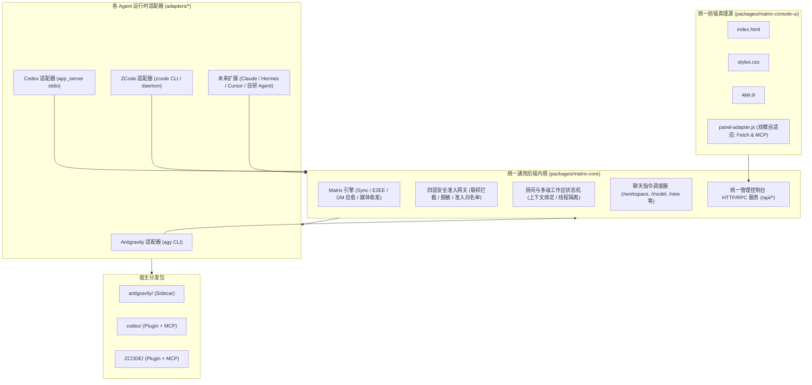

# Agents Matrix Bridge

<p align="center">
  <a href="README.md">English</a> | <b>简体中文</b>
</p>

[](LICENSE)
[](https://nodejs.org/)
[](#系统架构)
[](#自动化测试)

**Agents Matrix Bridge** 是面向多 AI Agent 生态的统一去中心化 Matrix 通信网关与管理中枢。它让 **Google Antigravity**、**OpenAI Codex**、**ZCode / Claude** 等异构 AI 编程助手能够以原生 Bot 身份接入 Matrix 房间与线程，实现多智能体同台协作、线程级上下文隔离、多级工作区动态切换、端到端加密防护（Pantalaimon）以及统一的可视化 Web 管理控制台。

---

## 🎯 为什么要做 Agents Matrix Bridge？

### 现状痛点：孤立的 AI 孤岛
现在的各家 AI 编码 Agent 极其强大，但彼此割裂在各自封闭的 IDE 或终端内：
- Google Antigravity 运行在专属 CLI / Sidecar 中；
- OpenAI Codex 运行在自己的 app-server 沙盒与终端中；
- Claude / ZCode 运行在各自的 Webview 面板或单独的工作区中。

开发者如果想让不同的 Agent 协同，只能在多个窗口间频繁切换，手动复制粘贴提示词、代码片段与报错信息，人肉充当“消息路由器”，会话历史也无法共享沉淀。**市面上一直缺乏一个中立、开放、支持多端广播与私聊的统一协作总线**。

### 核心解法：将 Matrix 打造为多 Agent 协同的神经总线
**Matrix** 是一套开放、去中心化、支持联邦与端到端加密（E2EE）的标准即时通信协议：
1. **多 Agent 同群协作**：你可以将 `@antigravity:server`、`@codex:server` 和 `@zcode:server` 同时拉进同一个 Matrix 研发房间。Antigravity 负责架构顶层设计，Codex 在子线程并行编码，ZCode 审查安全与运行单测，多 Agent 像人类产研团队一样交流协同。
2. **人类工程师随时介入把控**：你可以在手机、电脑或网页上的任何 Matrix 客户端（Element、FluffyChat、Cinny 等）随时查看进度、审批命令执行、给出指导建议。
3. **数据主权与隐私安全**：支持通过 Docker 5 秒启动本地轻量 Matrix 服务（Conduit）或官方服务（Synapse），对话、上下文与代码完全停留在本地私有网络，绝不泄露商业机密。

---

## 🌟 核心特性亮点

- **🔌 通用 Core + Adapter 现代化架构**：
  90% 的协议解析、DM 自愈、四层安全准入、工作区遍历与 REST 服务收敛在 `@matrix-bridge/core` 内核中。新增接入一款全新的 Agent 仅需不到 100 行适配代码。
- **🛡️ 四层安全准入与防泄漏网关**：
  - **联邦拦截**：阻断未授权的跨站服务器成员窥探私有代码工作区；
  - **白名单策略**：支持房间级与全局身份访问控制（`all`、`allowlist`、`admin`、`none`）；
  - **密钥脱敏**：出站消息全自动抹除 Matrix Token（`syt_`）、OpenAI Key（`sk-`）、GitHub Token（`ghp_`）和私钥证书；
  - **滑动窗口限流**：防御恶意灌水与消息洪峰，管理员享有高优通行权。
- **💬 智能上下文与 Thread 状态机**：
  - **1 对 1 私聊自愈**：通过 `account_data/m.direct` 实时识别，私聊中无需 `@bot` 前缀，直接畅聊；
  - **群聊自动署名**：群聊中自动追加 `[发信人: 昵称 (@user:server)]` 头部，帮助模型精准区分不同协同成员；
  - **Matrix Thread 子会话拆分**：群成员在任何消息上开辟 Thread（线程回复），系统自动派生独立的 Agent 子会话，上下文完全隔离。
- **📂 动态工作区多级下钻浏览器**：
  - 支持在聊天中用 `/workspace <路径>` 动态切换工作目录；
  - 提供类似 macOS Finder 的多级面包屑、Git 仓库自动标识与模糊搜索。
- **🎨 统一前端单一真理源**：
  - 管理台所有界面在 `packages/matrix-console-ui` 统一维护，自动适配深浅色主题；
  - **双模自适应**：在浏览器走标准 HTTP API，在 MCP 容器走 `app.callServerTool`。
- **📦 零外部依赖纯净内核**：
  - `@matrix-bridge/core` 完全基于 Node.js 原生标准库（`node:fs`、`node:http`、`node:crypto`），没有任何第三方 npm 膨胀包。

---

## 🏗️ 系统架构



---

## 🚀 极速上手：傻瓜式一键配置与安装

### 1. 前置条件

- **Node.js**：`>= 18.0.0`
- 系统中已安装任意一家或多家 Agent CLI（Antigravity / Codex / ZCode）
- （可选）已安装 Docker（若需本地一键部署 Matrix 服务）

### 2. 运行交互式向导脚本

```bash
git clone https://github.com/bigbearcool/agents-matrix-bridge.git
cd agents-matrix-bridge

./install.sh
```

向导将按步骤引导完成：
1. **中英文语言选择**；
2. **Matrix 服务检测**：自动检测本机 Docker、端口与系统服务；若未检测到，支持**一键拉起轻量 Conduit（2 秒就绪，内存仅需 50MB）**或官方 Synapse；
3. **账号与服务器凭证配置**：自动完成连通性校验；
4. **Agent 插件自动安装**：自动检测本机运行时并完成插件注册、配置注入与守护进程拉起。安装完毕即可在 Matrix 客户端直接开始聊天！

也可以在 CI/CD 或终端静默执行：

```bash
./install.sh --all            # 为检测到的所有 Agent 一键安装
./install.sh --antigravity    # 仅安装 Antigravity 插件
./install.sh --codex          # 仅安装 Codex 插件
./install.sh --zcode          # 仅安装 ZCode 插件
```

---

## 💬 房间聊天指令大全

在 Matrix 客户端房间内，管理员和受信任成员可通过斜杠指令实时操控 Agent：

| 命令 | 示例 | 功能说明 |
| :--- | :--- | :--- |
| `/status` | `/status` | 查看当前机器人状态、工作区路径、活跃模型与 Matrix 同步状态 |
| `/workspace` | `/workspace /Users/dev/myapp` | 动态切换当前房间关联的项目代码工作区目录 |
| `/model` | `/model gemini-2.5-pro` | 查看可用模型列表或切换当前使用的模型 |
| `/effort` | `/effort high` | 设置模型思考/推理深度级别（`low` / `medium` / `high`） |
| `/new` | `/new` | 重置当前房间的上下文记忆，开启一个全新的对话 Session |
| `/policy` | `/policy allowlist` | 修改房间的安全准入策略（仅管理员可用） |
| `/help` | `/help` | 查看详细帮助与当前运行时特有说明 |

> **提示**：在多人研发群聊中，指令需以 `@机器人名` 开头（如 `@antigravity /workspace /my/project`），避免群内多个 Bot 抢答冲突；在 1 对 1 私聊中可直接发送斜杠指令，无需 `@`。

---

## 🛠️ 本地开发与贡献

```bash
# 校验并构建 UI，将产物全自动同步分发至各宿主目录
npm run sync

# 仅构建 UI 包
npm run build:ui

# 运行全量单测与回归测试
npm test
```

### 自动化测试套件

项目包含 **87 个端到端与单元测试**（使用 Node.js 原生 `node:test` 测试框架，~2.2 秒极速跑完）：
- **`npm run test:core`**（51 项）：覆盖 Matrix 同步、DM 自愈、Pantalaimon E2EE、安全网关、敏感词脱敏、实例锁与管理台 REST API。
- **`npm run test:adapters`**（33 项）：覆盖各 Agent 适配器契约实现、子进程生命周期、会话恢复与模型发现。
- **`npm run test:codex`**（3 项）：覆盖宿主独立进程拉起与 MCP stdio 协议交互。

---

## 📖 开发者文档

- [AGENTS.md](AGENTS.md) — 针对 AI Agent 与核心贡献者的架构规范与接入指引。
- [CLAUDE.md](CLAUDE.md) — Claude Code 与日常开发常用命令速查。

---

## 📄 开源协议

本项目采用 [MIT 许可证](LICENSE) 开源。
